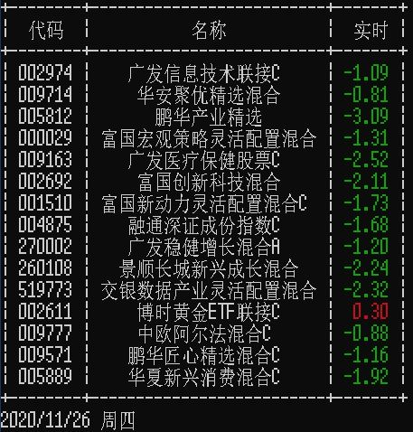
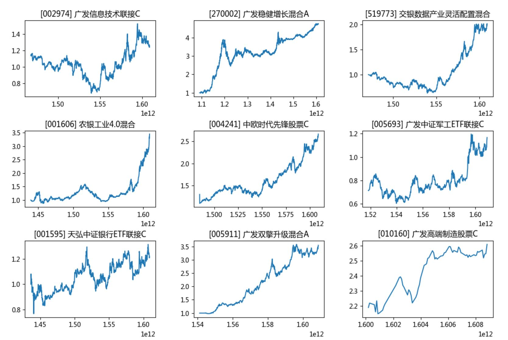

# Eastmoney1234567

Make money, quickly quickly. Utilization of 1234567 fund APIs.

## Usage

 - Input fund code into a XLSX file and make a list with name and benefit rate in recent years (optional):

 `make_sheet <fund_list.xlsx> <ifGetRate, 0 or 1>`

 - Launch the monitor:

 `monitor <fund_list.xlsx> <delay> [threadNum]`

 

 - Show a curve wall:

 `python3 k-wall.py <fund_list.xlsx> [backtracking_days]`

 

 - Generate a one-minute candlestick and MACD chart (defaults to the
   Shanghai-Shenzhen 300 Index if no arguments are provided):

 `python dailychart\chart-srv.py [six_digit_code name] [--filename image.jpg]`

 For example: `python dailychart\chart-srv.py 600000 浦发银行`. Use
 `--security-type index` to query an index instead. Each code has its own
 minute-data cache and chart in `dailychart\data\minute_cache` and
 `dailychart\charts`. The default image filename is
 `<code>-<security_type>-latest.jpg`; override it with `--filename`. Absolute
 paths are used directly; relative paths are resolved under `dailychart\charts`.
 For example: `--filename "D:\charts\my-chart.jpg"` or
 `--filename "custom\my-chart.jpg"`. Network requests use a direct connection
 by default; configure an HTTP or SOCKS5 proxy with `--proxy`, for example
 `--proxy http://127.0.0.1:8080` or `--proxy socks5://127.0.0.1:1080`.
 HTTP requests reuse a session to keep connections alive, with a 15-second
 connect timeout and a 30-second read timeout.

## For those who want to build a executable

> https://github.com/pyinstaller/pyinstaller/issues/5319

 - If the exeutable made by pyInstaller shows the error "prettytable distribution was not found", copy hook-prettytable.py to the hook directory.

 - For Windows, the path maybe

 `...\Python36\Lib\site-packages\PyInstaller\hooks`